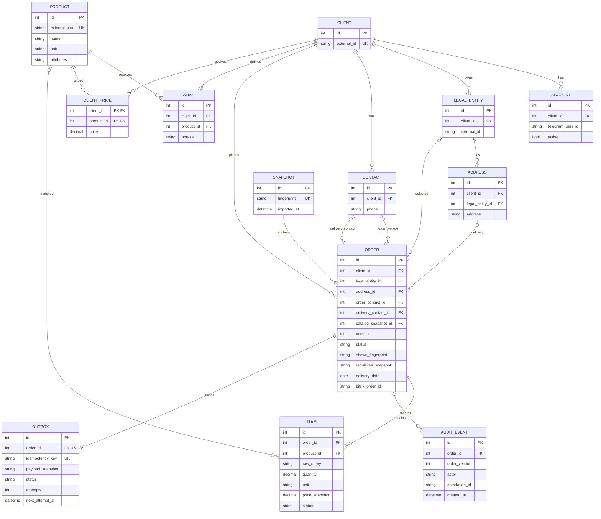
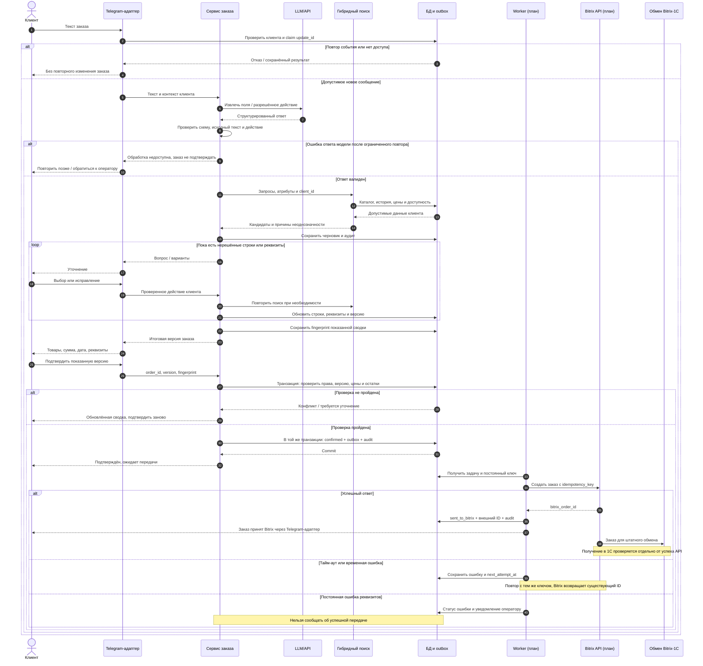
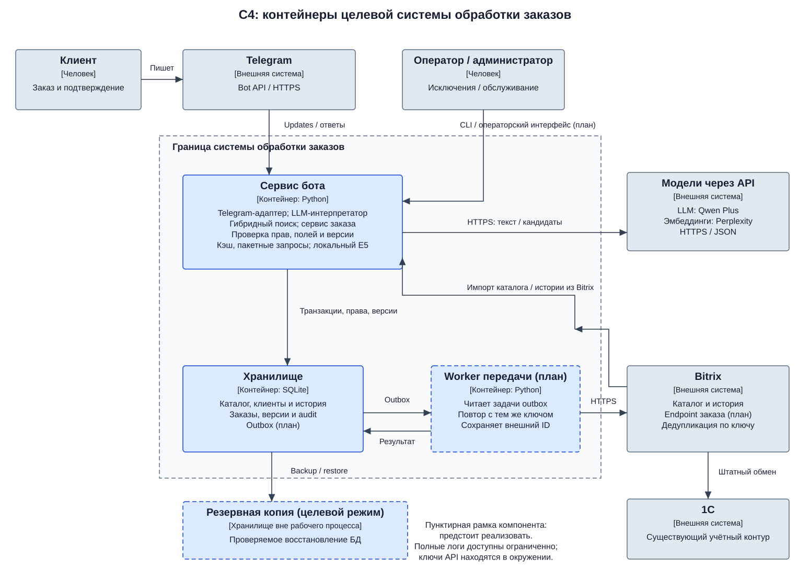
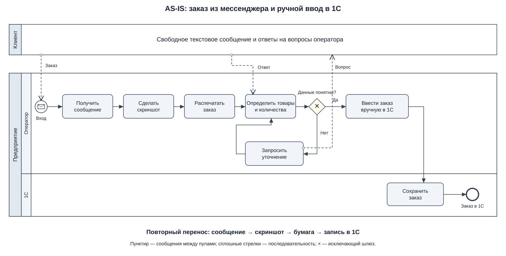
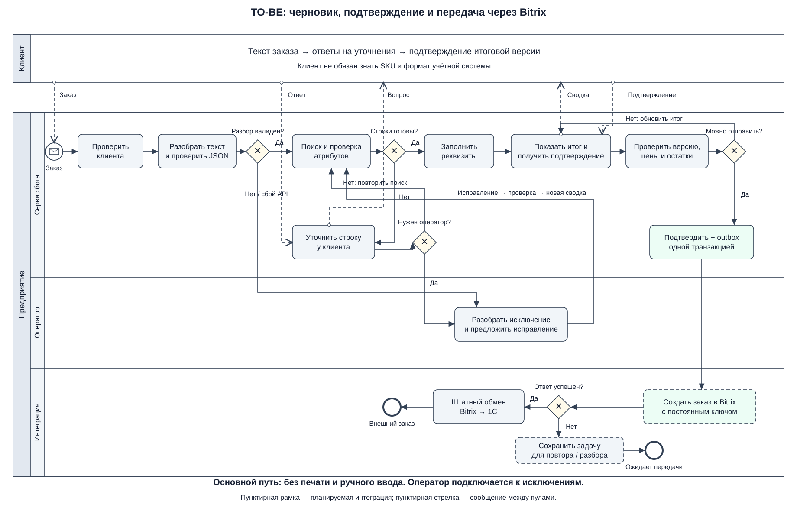

# ЛР 3 — Проектирование информационной системы

**Тема ВКР:** Разработка интеллектуальной системы обработки неструктурированных заказов на основе LLM и семантического поиска.

**Автор:** Дущенко Даниил Александрович.

**Формат работы:** индивидуальный.

**Дата:** 12 октября 2026 года.

## 1. Предметная область и требования

### 1.1. Описание предметной области

Проект относится к приёму B2B-заказов на продукты питания. Клиенты пишут в мессенджерах названия товаров, количества и пожелания к доставке без единого шаблона. Операторы делают скриншоты, печатают сообщения и вручную переносят сведения в 1С. При неполном названии товара необходимы уточнения: «молоко» может соответствовать нескольким брендам, жирностям и фасовкам, а «две банки» должно быть согласовано с единицей конкретной позиции каталога.

Я проектирую систему с текстовым интерфейсом Telegram. Она строит черновик из сообщения, находит кандидатов в каталоге и запрашивает недостающие сведения. Клиент может исправить строки и подтверждает итоговую версию заказа. Оператор подключается к случаям, которые нельзя надёжно разрешить автоматически. Администратор поддерживает каталог, привязки клиентов и настройки.

LLM интерпретирует текст и выбирает действие из разрешённого набора, но не является источником цен, идентификаторов товаров или прав доступа. Эти сведения берутся из каталога и хранилища. Семантический поиск дополняет лексический поиск, а история клиента помогает ранжировать допустимые товары, не отменяя явно указанные атрибуты.

**Граница системы:** приём сообщения, извлечение данных, поиск, уточнения, реквизиты, подтверждение и передача в Bitrix. Складской учёт, проведение документов и дальнейшие операции в 1С остаются за существующими системами. Прямой записи бота в 1С не предусматривается.

**Состояние на дату отчёта:** реализован прототип на Python с SQLite, Telegram, API-интерпретацией, гибридным поиском, импортом каталога и истории Bitrix, редактированием и тестовым подтверждением. Ниже описываю целевую систему. Интеграционный worker, outbox, создание заказа в Bitrix и полноценное рабочее место оператора являются проектными решениями для дальнейшей реализации. Обработка изображений и голоса в текущий объём не включена.

### 1.2. Функциональные требования

| ID | Требование | Способ проверки |
|---|---|---|
| FR-01 | Система принимает текст в Telegram от аккаунта, привязанного к клиенту, и проверяет принадлежность открываемого заказа этому клиенту. | Привязанный пользователь создаёт свой черновик; непривязанный получает предложение обратиться за привязкой; доступ к чужому заказу отклоняется. |
| FR-02 | Из сообщения выделяются товарные строки, явно указанные количества и единицы, дата доставки и комментарий. Отсутствующее количество не выдумывается. | Набор размеченных сообщений: сравнение полей; «молоко 3,5% 2 шт» сохраняет процент как атрибут, а 2 как количество. |
| FR-03 | По каждой строке система получает кандидатов гибридным поиском и проверяет явно заданные бренд, жирность, фасовку и единицу. История клиента влияет только на допустимых кандидатов. | Положительные и отрицательные запросы; «масло 500 г» не подтверждается как фасовка 1 кг; конфликт истории с сообщением разрешается в пользу ограничения сообщения. |
| FR-04 | При неоднозначности, отсутствии товара или количества, несовпадении единиц система запрашивает уточнение. Неразрешённая строка блокирует подтверждение. | Выбор кандидата и уточнение количества; попытка подтвердить незавершённый заказ отклоняется. |
| FR-05 | Клиент добавляет, заменяет и удаляет позиции, меняет количество и продолжает сохранённый черновик. Изменения пересчитывают итог и делают прежнее подтверждение недействительным. | Сценарий редактирования и попытка подтвердить ранее показанную версию после изменения. |
| FR-06 | Для оформления система получает юрлицо, связанный адрес, дату доставки и контакты для заказа и доставки. Сохранённые реквизиты выбираются только из профиля текущего клиента. | Проверка обязательных полей и отклонение адреса другого клиента или другого юрлица. |
| FR-07 | Перед подтверждением показываются итоговые товары, количества, единицы, цены, сумма и реквизиты. При подтверждении повторно проверяются версия, доступность и остатки, включая сумму одинакового SKU в разных строках. | Изменение остатка или версии между показом и нажатием кнопки блокирует прежнее подтверждение и вызывает обновление сводки. |
| FR-08 | После подтверждения создаётся задача передачи заказа в Bitrix. Успешный ответ сохраняет внешний ID, после чего заказ участвует в существующем обмене Bitrix–1С. | Проверка в тестовом контуре: один заказ в Bitrix, совпадающие позиции и реквизиты, наличие заказа после штатного обмена в 1С. |
| FR-09 | Повторное Telegram-событие или повтор задачи передачи не создаёт второй заказ. После временной ошибки передачи выполняются контролируемые повторы с тем же ключом. | Повтор одного update и нескольких запросов с одним ключом; проверка одного внешнего заказа, в том числе после тайм-аута ответа. |
| FR-10 | Клиент может передать нерешённый заказ оператору; оператор получает строки и причину, предлагает исправления, а клиент подтверждает обновлённую сводку. | Сценарий передачи, исправления и возврата к подтверждению без повторного ввода всего заказа. |
| FR-11 | Администратор импортирует актуальный каталог; обновление не удаляет историю, а подтверждённый заказ сохраняет снимок использованных сведений. | Повторный импорт и изменение названия/цены: история сохраняется, старые снимки заказа не переписываются. |
| FR-12 | Система сохраняет историю статусов, изменений и попыток передачи с идентификатором связи; после успешного заказа обновляет персональные обозначения товара. | Восстановление последовательности событий заказа; отсутствие обучения алиаса на неподтверждённом выборе. |

### 1.3. Нефункциональные требования

Числа ниже — целевые критерии приёмки, которые необходимо проверить экспериментально. Они не описывают уже достигнутые показатели. В частности, наличие схемы и таблиц само по себе не подтверждает выполнение требований к надёжности.

| ID | Требование | Способ проверки |
|---|---|---|
| NFR-01 | Изоляция клиентов: ни один из предусмотренных отрицательных сценариев доступа не раскрывает и не изменяет чужой заказ, реквизиты, цены или историю. | Автоматические проверки всех операций чтения и изменения с двумя разными клиентами; ожидается 0 нарушений. |
| NFR-02 | На фиксированном нагрузочном наборе с каталогом до 10 000 SKU и заказом до 10 строк 95-й перцентиль первого содержательного ответа не превышает 30 с при двух одновременных диалогах. | Замеры с указанием оборудования, модели, сетевых условий и включением API-задержки; тайм-ауты учитываются как неуспешные ответы. |
| NFR-03 | Подтверждение и создание outbox-задачи атомарны. После перезапуска подтверждённый, но не переданный заказ доступен для повторной доставки; повтор задачи не создаёт дубликат в Bitrix. | Прерывание процесса до и после фиксации транзакции, после внешнего сохранения и до получения ответа; проверка восстановления. |
| NFR-04 | Некорректный JSON, неизвестное действие LLM, несуществующий SKU и невалидное количество не приводят к подтверждению или внешней записи. | Набор ошибочных ответов модели и конфликтов полей; ожидается 0 невалидных подтверждений. |
| NFR-05 | Для каждого изменения заказа и попытки передачи записываются время, актор, версия и correlation ID. Ключи API не попадают в логи; телефоны и адреса маскируются в обычной диагностике. | Проверка полноты аудита и поиск контрольных секретов/реквизитов в логах. Доступ к полному техническому аудиту ограничен. |
| NFR-06 | Каталог, история и заказы сохраняются после идемпотентной миграции. Ежедневная резервная копия восстанавливается с целевыми RPO ≤ 24 ч и RTO ≤ 1 ч. | Два запуска миграции, восстановление копии на изолированной базе, проверка числа заказов и ссылочной целостности. |
| NFR-07 | Для ясного заказа с полным профилем и указанной датой после первого сообщения требуется не более двух действий клиента до постановки на отправку. | Сценарии без неоднозначностей; счётчик действий, включая явное итоговое подтверждение. |
| NFR-08 | Модель и API-провайдер задаются конфигурацией через единый интерфейс. На контрольном наборе неподходящих товаров и конфликтующих атрибутов нет ошибочных автоматических сопоставлений. | Прогон локального и API-варианта на одном наборе; фиксируются версия модели, доля уточнений, ошибки и стоимость. Нулевая ошибка на наборе не означает нулевой риск в эксплуатации. |

## 2. Обзор нотаций и видов диаграмм

| Нотация или вид диаграммы | Что описывает | Сильные стороны для проектирования ИС |
|---|---|---|
| BPMN 2.0 | Процессы, участников, события, условия и обмен сообщениями | Позволяет показать ответственность оператора и клиента, ветви исключений и переход AS-IS → TO-BE. |
| IDEF0 | Функции, входы, выходы, управление и механизмы | Удобна для определения границ функций и роли каталога и бизнес-правил. |
| DFD | Потоки данных, процессы, внешние сущности и хранилища | Выделяет, какие данные переходят между сообщением, разбором, каталогом и учётной системой. |
| ER-модель | Сущности, атрибуты и связи с кардинальностями | Показывает заказ, позиции, клиента и реквизиты; помогает спроектировать ограничения БД. |
| UML use case | Цели акторов и возможности системы | Даёт обзор функций клиента, оператора и администратора. |
| UML sequence | Взаимодействия участников во времени | Позволяет разобрать подтверждение, вызовы модели, транзакцию и повтор внешнего запроса. |
| UML state machine | Состояния и допустимые переходы объекта | Удобна для жизненного цикла черновика и блокировки подтверждения при незавершённых строках. |
| UML deployment | Узлы выполнения и размещение программных элементов | Помогает определить границы сервера бота, базы и внешних систем. |
| C4, уровень контейнеров | Приложения, хранилища и связи между ними | Объясняет архитектуру и технологические границы без подробностей каждого класса. |
| DMN | Решения и формализованные бизнес-правила | Подходит для таблиц правил даты доставки, ограничений заказа и выбора действия при дефиците. |

Для BPMN и UML использованы спецификации OMG [1, 2], для C4 — описание модели её автора [3].

## 3. Выбор нотаций для проекта

Я выбрал четыре позиции, каждая из которых отвечает на отдельный вопрос о системе.

| Нотация или вид диаграммы | Что моделирую | Связанные требования | Обоснование |
|---|---|---|---|
| BPMN | Текущий и целевой процесс заказа, уточнения и участие оператора | FR-01–FR-10; NFR-04, NFR-07 | Нужны явные ветви неполного заказа и отказа модели, а также сравнение ручного ввода с автоматическим построением черновика. |
| ER-модель | Заказы, товары, клиентские реквизиты, аудит и outbox | FR-01, FR-03, FR-05–FR-12; NFR-01, NFR-03, NFR-05, NFR-06 | Кардинальности и ключи задают основу изоляции и сохранения согласованной версии заказа. |
| UML sequence | Сообщение → разбор → поиск → подтверждение → Bitrix | FR-02–FR-09, FR-12; NFR-03, NFR-04, NFR-08 | Временной порядок важен: LLM не изменяет заказ напрямую, а внешняя отправка начинается после транзакционного подтверждения. |
| C4, контейнеры | Сервис бота, БД, фоновая передача, внешние модели и учётные системы | FR-08–FR-12; NFR-01–NFR-06, NFR-08 | Позволяет отделить существующий прототип от интеграционных компонентов и показать хранение и восстановление задач. |

BPMN отражает бизнес-логику, ER — данные и модель БД, UML sequence — порядок взаимодействия, C4 — архитектуру и направления передачи данных. UML use case и state machine рассмотрены в обзоре, но отдельные модели в этих видах не строятся: для объёма работы достаточно четырёх выбранных представлений.

## 4. Модели системы

### 4.1. Логическая модель данных — ER

Диаграмма показывает основные сущности целевой системы. `OUTBOX` — планируемая сущность интеграции; остальные группы имеют основу в прототипе. Модель укрупнена: диагностические таблицы, кэш запросов и сессии Telegram не показаны.

**Пояснение.** Заказ принадлежит одному клиенту и содержит множество строк. До уточнения `ITEM.product_id` может быть пустым. Реквизиты также могут отсутствовать у черновика, но обязательны для подтверждения. Два контакта заказа могут ссылаться на одну запись. Связи с `CONTACT` показаны отдельно для двух ролей.

**Ограничения целостности.** Все выбранные реквизиты принадлежат клиенту заказа, адрес — выбранному юрлицу. Проверка производится в транзакции; где возможно, дополнительно применяются составные внешние ключи. Для активного Telegram-аккаунта разрешена одна привязка к клиенту. `ORDER.version` увеличивается при изменении; fingerprint связывает подтверждение с показанной сводкой. Денежные значения и количества вычисляются через Decimal; в SQLite допускается хранение точных десятичных строк.

В подтверждённом заказе сохраняются снимки цены, названия, единицы и реквизитов; справочник может измениться независимо от истории. `SNAPSHOT` задаёт версию каталога. Аудит фиксирует изменения, а `OUTBOX` хранит неизменяемый payload подтверждённой версии. Одна outbox-запись соответствует одному заказу, попытки обновляют её состояние. После подтверждения произвольное редактирование отправляемого payload запрещено; изменение требует отдельного согласованного сценария.

**Отражённые FR:** принадлежность клиенту — FR-01; товар, алиас и персональная цена — FR-03; строки и версия — FR-05; связи реквизитов — FR-06; snapshot и fingerprint — FR-07, FR-11; outbox и внешний ID — FR-08, FR-09; статусы передачи оператору и аудит — FR-10, FR-12.

**Учёт NFR:** клиентские ключи — NFR-01; outbox и атомарность — NFR-03; неизменяемый аудит — NFR-05; миграция и резервное копирование связанных сущностей — NFR-06. Схема поддерживает эти решения, но проверки доступа, маскирование и восстановление требуют реализации и тестов.

### 4.2. Взаимодействие при обработке заказа — UML sequence

**Пояснение.** Диаграмма показывает один заказ; дополнительные сообщения проходят ту же проверку доступа и защиту от повторов. Модель возвращает предложение действия, а сервис проверяет его перед записью. Разрешённый переход к подтверждению возможен только после разрешения товарных строк и заполнения реквизитов. Если цена или остаток изменились, требуется новая сводка и подтверждение.

Внешний запрос вынесен из транзакции БД. Это исключает удержание блокировки во время сетевого ожидания, но требует outbox. Идемпотентность должна поддерживаться не только ботом, но и точкой создания заказа на стороне Bitrix: уникальный ключ связывается с внешним заказом и повтор возвращает его ID. Если ответ потерян после сохранения заказа, новая попытка не должна создавать второй экземпляр. Конкретный URL и авторизация endpoint определяются на этапе интеграции; существование готовой ручки здесь не предполагается.

На стороне Bitrix перед созданием заказа повторно проверяются актуальные цены, остатки и допустимость реквизитов. Если подтверждённые условия изменились, endpoint возвращает конфликт; сервис формирует новую сводку для согласования с клиентом, а не подменяет состав или сумму молча.

**Отражённые FR:** извлечение — FR-02; поиск — FR-03; цикл вопросов — FR-04–FR-06; fingerprint и транзакционная проверка — FR-07; worker и обмен — FR-08; claim update и ключ — FR-09; аудит — FR-12. Передача оператору подробно показана в BPMN.

**Учёт NFR:** транзакция и повтор — NFR-03; валидация модели — NFR-04; журналирование — NFR-05; интерфейс внешней модели — NFR-08. Диаграмма показывает механизм, а его корректность проверяется сценариями отказов.

### 4.3. Архитектура — C4, уровень контейнеров

**Пояснение.** Основное приложение — сервис бота на Python. Telegram-адаптер, интерпретатор, поиск и сервис заказа являются его внутренними модулями, а не отдельными микросервисами. SQLite хранит каталог, реквизиты, версии, audit и планируемый outbox. Worker — проектируемый фоновый процесс передачи. Для первого интеграционного этапа он может использовать ту же БД; при росте нагрузки потребуются отдельная оценка блокировок и выбор серверной СУБД.

Модели LLM и эмбеддингов находятся за внешним API; альтернативный локальный энкодер подключается через интерфейс конфигурации. За пределами системы расположены Telegram, Bitrix и 1С. Соединения с внешними API используют HTTPS. Ключи хранятся в окружении сервиса, без включения в репозиторий и сообщения клиента. В LLM передаются только необходимые текст и контекст; передача телефонов и адресов исключается из промпта, если они не нужны для конкретной операции.

Пунктиром выделены ещё не реализованные компоненты интеграции. Резервная копия БД и настроек без секретов хранится отдельно от рабочего процесса. Доступ администратора и оператора разделён: оператору нужны заказы и причины уточнений, администратору — импорт, привязки и обслуживание.

**Отражённые FR:** внешняя передача и существующий обмен — FR-08; worker/outbox — FR-09; оператор — FR-10; административный импорт — FR-11; БД и аудит — FR-12.

**Учёт NFR:** проверка принадлежности клиента на входе и в сервисе — NFR-01; кэш эмбеддингов и пакетная обработка запросов — NFR-02; независимый worker — NFR-03; проверка результата LLM — NFR-04; ограниченный аудит — NFR-05; резервная копия — NFR-06; заменяемый API-интерфейс — NFR-08. Целевой предел задержки проверяется нагрузочным экспериментом, а не выводится из архитектурной схемы.

### 4.4. Процессная модель — BPMN

Процессная модель представлена парой AS-IS/TO-BE в разделе 5. Она является четвёртым представлением системы наряду с ER, UML sequence и C4. На TO-BE явно видны проверка пользователя, разбор и поиск, ветвь уточнения, участие оператора, подтверждение и передача.

**Отражённые FR:** FR-01–FR-10 через задачи и условия процесса. **Учёт NFR:** NFR-04 через ветвь сбоя разбора, NFR-07 через короткий путь ясного заказа. Ограничения производительности и восстановления раскрыты в архитектурной и последовательностной моделях.

### 4.5. Связь требований с моделями

| Требование | Основное место в моделях |
|---|---|
| FR-01 / NFR-01 | BPMN: проверка клиента; ER: CLIENT–ACCOUNT–ORDER; sequence: проверка доступа. |
| FR-02 / NFR-04 | BPMN: разбор и ветвь ошибки; sequence: проверка ответа LLM перед сохранением. |
| FR-03 / NFR-08 | C4: поиск и интерфейс энкодера; ER: PRODUCT, ALIAS, CLIENT_PRICE; sequence: получение кандидатов. |
| FR-04 | BPMN: цикл уточнений; sequence: loop; ER: статус ITEM и nullable product_id. |
| FR-05 | ER: ITEM и version; sequence: обновление после действия клиента. |
| FR-06 | ER: юрлицо, адрес и две роли контакта; BPMN: заполнение реквизитов. |
| FR-07 | ER: snapshot, version и fingerprint; sequence: проверка в транзакции. |
| FR-08 | C4: worker → Bitrix → 1С; sequence: внешний ID и штатный обмен. |
| FR-09 / NFR-03 | ER: OUTBOX и уникальный ключ; sequence: claim, атомарная запись и повтор; BPMN: ожидающая задача. |
| FR-10 | BPMN: задача оператора и возврат к клиенту; C4: операторский интерфейс. |
| FR-11 / NFR-06 | ER: SNAPSHOT и снимки заказа; C4: импорт и отдельная резервная копия. |
| FR-12 / NFR-05 | ER: AUDIT_EVENT; sequence: аудит изменения и передачи; C4: ограниченный доступ к диагностике. |
| NFR-02 | C4: кэш и пакетные запросы в сервисе; sequence: внешний API как источник задержки. |
| NFR-07 | BPMN TO-BE: при полных данных нет оператора и цикла уточнений, остаётся подтверждение. |

## 5. AS-IS и TO-BE

**Выбранная нотация:** BPMN 2.0. Использованы пулы клиента и предприятия, дорожки исполнителей, задачи, начальные и конечные события, исключающие шлюзы. Сплошная стрелка — поток управления внутри пула, пунктирная стрелка с незакрашенным наконечником — сообщение между пулами. Бизнес-правила из текста отчёта уточняют укрупнённые задачи схемы.

### 5.1. AS-IS — текущее состояние

Клиент отправляет свободный текст. Оператор получает сообщение, делает скриншот, печатает его, определяет товары и количества. Если данных недостаточно, он запрашивает уточнение и возвращается к разбору. Затем оператор вручную вводит заказ в 1С.

Схема описывает сообщённый текущий процесс, без предположения о формальном клиентском подтверждении или измеренной частоте ошибок. Каталог Bitrix и его обмен с 1С существуют в инфраструктуре, но новый канал бота к этому контуру пока не подключён.

Ограничения процесса: несколько представлений одного заказа, ручное сопоставление текста с номенклатурой, повторный ввод и зависимость от внимания оператора. Скриншот и распечатка не являются машинно-проверяемой структурой заказа. Время и частота ошибок ещё требуют замера.

### 5.2. TO-BE — целевое состояние

После проверки клиента сервис извлекает структуру сообщения, находит товарных кандидатов и проверяет ограничения. При недостаточных сведениях отправляет клиенту вопрос; неразрешимый случай или сбой интеллектуальной обработки может быть передан оператору. Исправления снова проходят проверку. Для ясного заказа эта ветвь пропускается.

После заполнения реквизитов клиенту показывается итог. Подтверждение проходит повторную валидацию и фиксируется вместе с задачей outbox. Worker создаёт заказ в Bitrix через проектируемый endpoint. При временной ошибке задача остаётся в ожидании и повторяется с тем же ключом; при постоянной ошибке требуется разбор оператором. Успешный заказ участвует в существующем обмене с 1С. Сообщение «передан в Bitrix» не означает, что обмен с 1С уже завершился.

**Изменения на схеме:** задачи «сделать скриншот», «распечатать» и «ввести вручную в 1С» заменены построением черновика и интеграционной передачей. Оператор находится в отдельной дорожке исключений. Проверка после подтверждения не допускает отправки устаревшей сводки, а неуспех интеграции приводит к ожидающей задаче, а не к сообщению об успехе.

### 5.3. Обоснование перехода

| Ограничение AS-IS | Решение TO-BE | Где отражено | Как оценить улучшение |
|---|---|---|---|
| Скриншот и распечатка для переноса сведений | Структурированный черновик из исходного текста | BPMN: «Разобрать текст», «Поиск и проверка» | Число ручных переносов на один заказ. |
| Ручной выбор похожей номенклатуры | Гибридный поиск, фильтры атрибутов и клиентская история | Sequence: H; ER: PRODUCT и ALIAS | Правильный SKU, ошибочные сопоставления и доля уточнений. |
| Оператор участвует в каждом заказе | Автоматический основной путь, оператор для исключений | BPMN: ветвь «Оператор» | Доля заказов без оператора и его активное время. |
| Несогласованные исправления текста | Версия заказа и подтверждение показанной сводки | ER: version/fingerprint; sequence: проверка версии | Число конфликтов, которые заблокированы до отправки. |
| Повторный ввод в учётную систему | Outbox, endpoint Bitrix и существующий обмен | C4 и sequence: worker → Bitrix → 1С | Доля успешно переданных заказов, дубликаты, задержка передачи. |

Переход зависит от подготовки актуального каталога, корректных привязок клиентов, реализации интеграционного endpoint и проверки обмена на тестовых заказах. Вводить систему следует поэтапно: сначала сравнение черновиков с результатом оператора, затем подтверждение клиентом в тестовом контуре и после проверки — рабочая передача. Доказательство сокращения времени требует сопоставимого замера AS-IS и TO-BE; диаграмма показывает устранённые операции, но не измеряет экономический эффект.

## 6. Выводы

В результате проектирования определены 12 функциональных и 8 нефункциональных требований, рассмотрены 10 нотаций и видов диаграмм, выбраны четыре взаимодополняющих представления. BPMN показывает ответственность и исключения, ER задаёт структуру данных и связи, UML sequence — порядок проверок и передачи, C4 — границы приложений и внешних систем.

Модели согласованы вокруг одного объекта — версионируемого заказа текущего клиента. Товар выбирается из каталога, цена и реквизиты фиксируются снимком, неразрешённые строки блокируют подтверждение, а внешняя передача начинается после атомарной записи. Во всех моделях создание заказа в Bitrix является целевым этапом; 1С получает его через существующий обмен.

Основное улучшение TO-BE — замена печати и ручного ввода машинным черновиком и интеграционной передачей, с сохранением уточнений и операторской помощи. Модели показывают способы выполнения требований, но не заменяют тестирование: ещё предстоят реализация интеграции, проверки отказов и измерение качества и трудозатрат.

## Источники

1. Object Management Group. **Business Process Model and Notation, Version 2.0.2.** 2014. [Спецификация](https://www.omg.org/spec/BPMN/2.0.2).
2. Object Management Group. **Unified Modeling Language, Version 2.5.1.** 2017. [Спецификация](https://www.omg.org/spec/UML/2.5.1).
3. Brown S. **The C4 model: Container diagram.** [Описание уровня контейнеров](https://c4model.com/diagrams/container).
4. Mermaid. **Entity Relationship Diagrams.** [Правила визуального представления ER](https://mermaid.js.org/syntax/entityRelationshipDiagram.html).
5. 1С-Битрикс. **Работа с заказами в API D7.** [Документация](https://dev.1c-bitrix.ru/api_d7/bitrix/sale/technique/orders.php).
6. 1С-Битрикс. **Протокол обмена заказами.** [Документация](https://dev.1c-bitrix.ru/api_help/sale/orders_protocol.php).

Дата обращения к электронным источникам: 12.10.2026.
